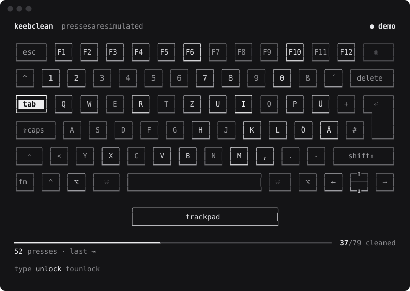

# keebclean

[](https://github.com/pyvnoaim/keebclean/actions/workflows/ci.yml)
[](https://github.com/pyvnoaim/keebclean/releases/latest)
[](LICENSE)

**Lock your Mac's keyboard and trackpad while you clean them, and watch every key light up as you wipe it.**



Most keyboard cleaning apps filter key events after macOS has already seen them, so Caps Lock still toggles, media keys still change the volume and brightness still jumps around. keebclean takes exclusive control of the keyboard at the HID level instead, so nothing you press reaches macOS at all.

## Features

- **A real lock.** Keyboards are seized at the HID level: letters, modifiers, Caps Lock, fn, media and brightness keys are all blocked.
- **Trackpad and mouse blocked too.** Moves, clicks, scrolling and gestures are dropped and the cursor is frozen.
- **A live keyboard in your terminal.** Every key you press lights up, using your actual layout (ANSI or ISO, and the labels of your current input source, e.g. German QWERTZ).
- **See what you missed.** Keys go from dim to white as you wipe them, getting brighter with every pass, and a progress bar counts the cleaned keys.
- **Screen cleaning.** `--screen` also turns every display black, so smudges stand out.
- **Switch sounds.** Drop in your own recordings of a mechanical switch.
- **Safe by default.** Type `unlock` to get your Mac back. A real lock also releases itself after 15 minutes.
- **No dependencies.** One Swift file, builds with the Xcode Command Line Tools.

## Requirements

- macOS 12 or later, Apple Silicon or Intel
- To build from source: Xcode Command Line Tools (`xcode-select --install`)

## Install

```sh
brew install pyvnoaim/tap/keebclean
```

or, without Homebrew:

```sh
curl -fsSL https://raw.githubusercontent.com/pyvnoaim/keebclean/main/install.sh | sh
```

The script downloads the latest release, verifies its checksum and sets keebclean up. To build from source instead: `git clone https://github.com/pyvnoaim/keebclean.git && cd keebclean && make`.

### Password-free locking

Locking the keyboard needs admin rights. The first time you lock (and once after each update), keebclean asks for your password and sets itself up so it never has to ask again:

- copies itself to `/Library/PrivilegedHelperTools/keebclean`, owned by root, so nothing running as you can replace it
- adds a sudo rule for exactly that file, pinned to its SHA-256 hash
- links `keebclean` into `/usr/local/bin` if nothing is there yet

`keebclean --uninstall` removes all of it.

## Usage

```sh
keebclean                  # lock keyboard and trackpad, type "unlock" to finish
keebclean --screen         # same, and black out every display
keebclean --timeout 300    # release automatically after 5 minutes (default: 15)
keebclean --test           # show key presses without locking anything, e.g. for screenshots
keebclean --demo           # simulated presses, no permissions needed
keebclean --mute           # no switch sounds
keebclean --version
```

Update with `brew upgrade keebclean`, or by running the install script again.

## Permissions

macOS asks for these the first time, for the terminal app you run keebclean in:

| Permission | Needed for |
| --- | --- |
| Input Monitoring | reading the keyboard (all modes except `--demo`) |
| Accessibility | blocking the trackpad and mouse |

Both live under **System Settings > Privacy & Security**.

## Switch sounds

keebclean plays recordings from a `sounds` folder next to the binary. None are included, since good recordings are rarely free to redistribute. Add short WAV, AIFF or CAF files named like this:

| File | Plays on |
| --- | --- |
| `press-generic*.wav` | a key press, one picked at random each time (3 to 5 variants sound most natural) |
| `release-generic.wav` | a key release |
| `press-space.wav`, `press-enter.wav`, `press-backspace.wav` | those keys, instead of the generic press |
| `release-space.wav`, `release-enter.wav`, `release-backspace.wav` | releasing those keys |

Trim the silence at the start of each file, or presses will feel delayed. Without any files keebclean is silent.

## How it works

- **Keyboard:** every keyboard HID device is opened with `kIOHIDOptionsTypeSeizeDevice`, which gives keebclean exclusive access, so macOS never receives the input. Devices that refuse (such as the headphone jack remote, which its audio driver holds) are skipped and listed on screen.
- **Trackpad:** trackpads are multitouch devices that can't be seized the same way, so a `CGEventTap` drops pointer events and the cursor is detached from the mouse.
- **Layout:** the key labels come from the current input source via `UCKeyTranslate`, and the physical layout (ANSI or ISO) from `KBGetLayoutType`.

## Security

The sudo rule means any program running as you can start keebclean as root without a password. So when it runs through sudo, keebclean only allows the lock itself: `--test`, `--install` and `--uninstall` are refused (test mode would otherwise be a keylogger that skips the Input Monitoring prompt), and `--timeout` is capped at 30 minutes.

## Limitations

- The power button and Touch ID are not part of the keyboard and can't be blocked. Holding the power button is the last resort if anything ever goes wrong.
- Only built-in MacBook layouts are drawn. External keyboards are locked, but drawn as the MacBook layout.

## Releasing

```sh
git tag v1.2.3 && git push origin v1.2.3
```

The release workflow stamps the version, builds the universal binary, publishes the GitHub release and updates the Homebrew formula in [pyvnoaim/homebrew-tap](https://github.com/pyvnoaim/homebrew-tap).

## License

[MIT](LICENSE)
